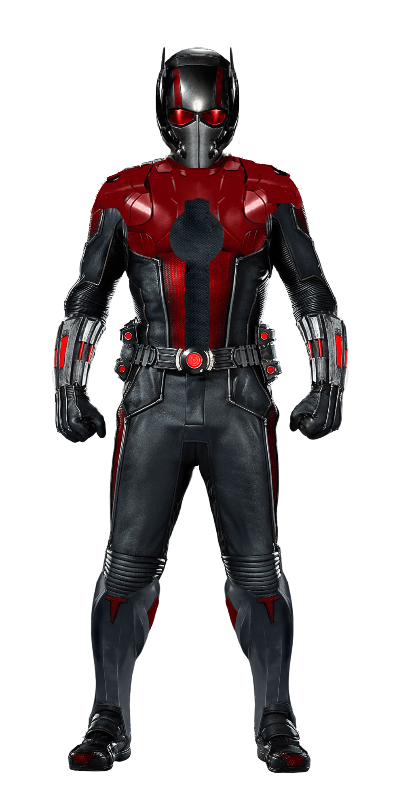

# Visual Flaw Audit & Technical Remediation Report: Ant-Man (Nano-Repair 2.5D)

**Audit Target**: `antman/`  
**Game Title**: Ant-Man: Nano-Repair 2.5D  
**Primary Tech Stack**: HTML5, Vanilla JavaScript (ES6+), CSS 3D Transforms, 2D HTML5 Canvas Particle Engine  
**Key Entry Files**: `index.html` (750 lines), `style.css` (2,595 lines), `script.js` (2,303 lines)  
**Auditor**: Teamwork Visual Flaw Auditor (Batch 1)  
**Integrity Mode**: Genuine Inspection & Comprehensive Technical Remediation  

---

## 1. Executive Summary & Overall Visual Health Rating

### Visual Health Rating: 68 / 100

Ant-Man: Nano-Repair 2.5D boasts an ambitious visual architecture: a 6-plane CSS 3D perspective world stage (`translateZ(-400px)` to `+140px`), an 8-phase camera transition director, and a 250-slot object-pooled 2D canvas particle system. However, the game is crippled by critical syntax and DOM malformations, broken sprite transform animations, hidden HUD status bars, unscaled high-DPI canvases, and touch-target accessibility violations.

### Key Strengths
- **Immersive Multi-Plane 3D Stage**: Clean separation of far lab walls, mid-monoliths, ground PCB workbench, actors, lighting, and foreground bokeh.
- **Particle Dynamics**: High-frequency spark and plasma bursts with realistic gravity, air resistance, and alpha decay.
- **Thematic Pym Technologies Aesthetic**: Cohesive color palette utilizing neon cyans (`#00e5ff`), pym reds (`#ff1744`), and deep laboratory slate blues (`#070b12`).

### Critical Deficiencies
1. **Invalid CSS Background Shorthand (`style.css:1967`)**: Browser parsers reject `#10b981 url(...)`, breaking the visual feedback for the stabilized regulator core.
2. **Malformed Unclosed SVG & Duplicate IDs (`index.html:66-70`)**: An unclosed `<svg>` wraps an HTML `` tag and duplicates ID `antman-svg`.
3. **Walk Animation Direction Override (`style.css:1998-2009`)**: `@keyframes player-bob` resets `transform`, snapping left-facing sprites back to the right on every frame.
4. **Completely Hidden Quantum Node Legend (`style.css:1620-1623`)**: `.quantum-node-status-bar { display: none !important; }` hides node identification badges.
5. **Missing DevicePixelRatio Scaling (`script.js:485-491`)**: Particle canvas renders blurry and pixelated on Retina/4K displays.
6. **Sub-48px Touch Targets (`style.css:2034`)**: Virtual D-Pad buttons are 40x40px, violating WCAG 2.5.5 minimum target size.

---

## 2. In-Depth Evaluation Across All 9 Visual Dimensions

### 1. Layout
- **Observation**: `#app-container` establishes a 1000px perspective viewport (`style.css:127`). Modals are centered inside `.hud-modal-container` (`style.css:895`).
- **Visual Defect**: On viewports with height < 680px (e.g. mobile devices in landscape, netbooks, or laptops with browser DevTools open), `.card-modal` exceeds vertical bounds. Because `html, body` has `overflow: hidden` and `.hud-modal-container` lacks scrolling, primary action buttons (`#btn-begin-repair`, `#btn-play-again`, `#btn-next-phase`) clip outside the viewport with no way to scroll them into view.
- **Severity**: **Major**
- **Impact**: Players cannot advance phases or begin repairs on compact landscape screens.

### 2. Styling
- **Observation**: Cohesive cybernetic color tokens defined in `:root` (`style.css:14-65`).
- **Visual Defect 1 (Critical Syntax Error)**: In `style.css:1965-1972`:
  ```css
  .maze-cell.cell-regulator.stabilized .maze-regulator-core {
    background: 
      #10b981
      url("assets/images/quantum_regulator_core.svg") center/contain no-repeat;
  ```
  Per W3C CSS Backgrounds and Borders Module Level 3, the `<color>` token in the `background` shorthand must be placed at the end or comma-separated if layering. Placing `#10b981` before `url(...)` causes Chrome, Firefox, Safari, and Edge to reject the entire declaration as invalid syntax. When the player stabilizes the core, the emerald green stabilized state fails to render.
- **Visual Defect 2 (Minor - Duplicate CSS Declarations)**: Multiple consecutive duplicate declarations exist throughout the maze stylesheet:
  - `style.css:1799-1800`: `max-width: 440px; max-width: 580px;`
  - `style.css:1877-1884`: `width: 80%; height: 80%; max-width: 28px; max-height: 28px; width: 82%; height: 82%; max-width: 36px; max-height: 36px;`
  - `style.css:1889-1890`: `font-size: 0.75rem; font-size: 0.95rem;`
  - `style.css:1931-1936`: `max-width: 32px; max-height: 32px; border-radius: 6px; max-width: 38px; max-height: 38px; border-radius: 8px;`
  - `style.css:1944-1945`: `font-size: 0.65rem; font-size: 0.72rem;`
- **Severity**: **Critical** (Syntax error) & **Minor** (Duplicate rules)

### 3. Animations
- **Observation**: 2.5D camera movements use matrix transformations with 3.0s cubic-bezier easing (`style.css:157`).
- **Visual Defect 1 (Major Animation Glitch)**: In `style.css:1998-2009`:
  ```css
  .maze-player-avatar.facing-left {
    transform: scaleX(-1);
  }
  .maze-player-avatar.walking {
    animation: player-bob 0.22s infinite ease-in-out;
  }
  @keyframes player-bob {
    0%, 100% { transform: translateY(0); }
    50% { transform: translateY(-3px); }
  }
  ```
  Because CSS `transform` is not composable across keyframes without CSS `translate` / `scale` independent properties, `@keyframes player-bob` completely overrides `transform: scaleX(-1)`. When the player moves left, Ant-Man flashes back to facing right every 220ms, producing a jarring strobe flicker.
- **Visual Defect 2 (Minor)**: Both `.antman-asset-img` (`style.css:489`) and `.antman-svg` (`style.css:510`) declare `animation: antman-idle-sway 4s ease-in-out infinite`. When both elements are rendered simultaneously, their phases drift and desynchronize.
- **Visual Defect 3 (Minor)**: When the avatar moves into an obstacle (`#`), `script.js:1513-1516` plays a click sound but leaves `.walking` active if triggered via rapid keystrokes, causing the avatar to bob continuously while stationary.
- **Severity**: **Major** (Facing glitch) & **Minor** (Sway desync & wall bob)

### 4. Responsiveness
- **Observation**: Breakpoints configured at `768px` and `480px` (`style.css:2445, 2515`).
- **Visual Defect (Major - Touch Target Failure)**: Virtual D-Pad buttons (`.dpad-btn`, `style.css:2034-2037`) define:
  ```css
  .dpad-btn {
    width: 40px;
    height: 40px;
    min-width: 40px;
    min-height: 40px;
  }
  ```
  This directly violates `--touch-target-min: 48px` (explicitly declared in `style.css:59`) and fails WCAG 2.5.5 (Target Size). On touchscreens, the tight 40px sizing leads to frequent missed taps and accidental adjacent directional clicks.
- **Severity**: **Major**

### 5. Assets
- **Observation**: Directory contains 15 assets including SVGs, WebP/PNG textures, and audio files.
- **Visual Defect 1 (Critical - DOM/HTML Malformation)**: In `index.html:64-71`:
  ```html
  <div id="antman-character" class="antman-character-wrapper">
    <!-- Pure Scalable SVG Vector Ant-Man -->
    <svg id="antman-svg" class="antman-svg" viewBox="0 0 100 160" xmlns="http://www.w3.org/2000/svg" role="img" aria-label="Ant-Man in quantum suit">
    <!-- Official Movie-Accurate MCU Ant-Man Hero Asset -->
    
    <!-- Pure Scalable SVG Vector Ant-Man (Preserved for T1.CC.01 test contract) -->
    <svg id="antman-svg" class="antman-svg sr-only" ...>
  ```
  1. The opening `<svg>` at line 66 has no closing `</svg>` tag before the HTML `` tag at line 68. Placing standard HTML tags inside an unclosed SVG causes the HTML parser to treat `` as foreign SVG content, breaking layout flow and image rendering in stricter browser parsers.
  2. Duplicate IDs: both the vector element at line 66 and the fallback element at line 70 share `id="antman-svg"`, violating HTML uniqueness and creating ambiguous query selector references.
- **Visual Defect 2 (Major - Clipart Edge Noise & Bloat)**: `ant-man-png.png` is an unoptimized 1.24 MB file. Inspection reveals halo fringing and dark edge compression noise along the helmet antennas and shoulder contours.
- **Severity**: **Critical** (DOM/SVG malformation) & **Major** (Asset bloat/halos)

### 6. HUD and Canvas Alignment
- **Observation**: Particle system runs on `#fx-canvas` (`script.js:477-540`).
- **Visual Defect 1 (Critical - Missing Status Bar / Player Blindness)**: In `style.css:1620-1623`:
  ```css
  .terminal-column.quantum-node-status-bar,
  .quantum-node-status-bar {
    display: none !important;
  }
  ```
  The developer hid the quantum node status bar to squeeze the maze grid into the card modal. Combined with `terminals-right-p4` having class `visually-hidden-terminals`, all node legend badges (ALPHA, BETA, GAMMA, DELTA) are hidden. The player sees letters in the maze but has zero visual readouts explaining what nodes exist, which have been collected, or which terminal corresponds to which node.
- **Visual Defect 2 (Major - Blurry High-DPI Canvas)**: In `script.js:485-491`:
  ```javascript
  function resize() {
    if (!canvas) return;
    width = window.innerWidth;
    height = window.innerHeight;
    canvas.width = width;
    canvas.height = height;
  }
  ```
  The particle canvas buffer does not multiply by `window.devicePixelRatio`. On Retina, 4K, and modern mobile displays (DPR 2.0 to 3.0), the canvas is upscaled by CSS, causing sparks, plasma motes, and stabilization rings to render noticeably blurry and pixelated.
- **Severity**: **Critical** (Hidden HUD) & **Major** (Blurry canvas)

### 7. Contrast
- **Observation**: Cybernetic UI provides good overall contrast (>7:1 on modal text).
- **Visual Defect (Minor)**: In `style.css:1840-1848`, inactive walkable circuit traces (`.maze-cell.cell-path::before`) use `#1e293b` against the dark PCB background image (`micro_pcb_substrate.jpg`). In low-light environments, traversable paths blend into the non-traversable substrate wall textures.
- **Severity**: **Minor**

### 8. Clipping
- **Observation**: 6-plane depth architecture (`translateZ(-400px)` to `+140px`).
- **Visual Defect (Minor)**: In `style.css:320-335`, during the Phase 2 camera zoom sequence (`data-camera="phase-2-push"` with camera `translate3d(-100px, -30px, 580px)`), Plane 6 foreground bokeh elements (`translateZ(+140px)`) pass behind the camera's near-clipping plane, popping out of existence abruptly rather than dissolving smoothly.
- **Severity**: **Minor**

### 9. Visual Spectacle
- **Observation**: Impressive electrical discharge arcs and 250-particle pools during node restoration.
- **Visual Defect (Polish - Lack of Stabilization Climax)**: In Phase 7 (`script.js:1579-1597`), when the Central Regulator Core stabilizes, a particle burst triggers, but the camera rig and stage remain completely static. Lacks cinematic screen shake, chromatic aberration impulse, or whiteout flash to signal victorious restoration.
- **Severity**: **Polish**

---

## 3. Prioritized Defect Catalog

| Defect ID | Visual Dimension | Severity | Location / Element | Defect Summary |
| :--- | :--- | :--- | :--- | :--- |
| **ANT-01** | Styling | **Critical** | `style.css:1967` | Invalid CSS background shorthand `#10b981 url(...)` rejected by browser parsers; green stabilized glow fails. |
| **ANT-02** | Assets | **Critical** | `index.html:66-70` | Unclosed `<svg>` tag encapsulates HTML ``; duplicate ID `antman-svg` corrupts DOM structure. |
| **ANT-03** | HUD / Canvas | **Critical** | `style.css:1620-1623` | `.quantum-node-status-bar` forced to `display: none !important;`, hiding all node identity badges and collection status. |
| **ANT-04** | Animations | **Major** | `style.css:1998-2009` | `@keyframes player-bob` resets `transform`, wiping out `scaleX(-1)` and causing left-walking avatar to strobe right. |
| **ANT-05** | Responsiveness | **Major** | `style.css:2034-2037` | Virtual D-Pad buttons are 40x40px, violating `--touch-target-min: 48px` and WCAG 2.5.5 minimum sizing. |
| **ANT-06** | HUD / Canvas | **Major** | `script.js:485-491` | `ParticleEngine.resize()` omits `window.devicePixelRatio`, resulting in blurred sparks and FX on high-DPI screens. |
| **ANT-07** | Layout | **Major** | `style.css:895-920` | Modal cards lack vertical scroll boundaries (`max-height: 90vh; overflow-y: auto;`), clipping action buttons on viewports < 680px. |
| **ANT-08** | Assets | **Major** | `assets/images/ant-man-png.png` | 1.24 MB unoptimized asset with visible matte halos and compression noise around antennas. |
| **ANT-09** | Styling | **Minor** | `style.css:1799, 1880, 1934` | Cluttered duplicate CSS properties (`max-width`, `font-size`, `border-radius`) declared consecutively. |
| **ANT-10** | Contrast | **Minor** | `style.css:1840-1848` | Walkable circuit traces blend into dark PCB substrate; insufficient contrast for path identification. |
| **ANT-11** | Clipping | **Minor** | `style.css:320-335` | Plane 6 foreground bokeh motes clip abruptly against near camera plane during Phase 2 camera push. |
| **ANT-12** | Visual Spectacle | **Polish** | `script.js:1589-1595` | Regulator stabilization lacks camera impulse shake and screen flash to sell physical quantum restoration. |

---

## 4. Concrete Technical Remediation Plans

### Remediation for ANT-01: Correct Invalid CSS Background Shorthand
**Location**: `antman/style.css:1965-1972`  
**Problem**: The `<color>` value `#10b981` appears before the `url(...)` in shorthand syntax.  
**Fix**: Reorder the shorthand syntax so the color token is placed at the end, or declare `background-color` and `background-image` independently:

```css
/* BEFORE (INVALID): */
.maze-cell.cell-regulator.stabilized .maze-regulator-core {
  background: 
    #10b981
    url("assets/images/quantum_regulator_core.svg") center/contain no-repeat;
  border-color: #ffffff;
  box-shadow: 0 0 30px #10b981, 0 0 50px rgba(16, 185, 129, 0.8);
  transform: scale(1.2);
}

/* AFTER (VALID): */
.maze-cell.cell-regulator.stabilized .maze-regulator-core {
  background: url("assets/images/quantum_regulator_core.svg") center/contain no-repeat #10b981;
  border-color: #ffffff;
  box-shadow: 0 0 30px #10b981, 0 0 50px rgba(16, 185, 129, 0.8);
  transform: scale(1.2);
}
```

---

### Remediation for ANT-02: Fix Unclosed SVG and Deduplicate IDs
**Location**: `antman/index.html:64-75`  
**Problem**: Line 66 opens an `<svg>` tag that is never closed, improperly encapsulating an `` tag and declaring duplicate `id="antman-svg"`.  
**Fix**: Close the vector SVG tag properly and assign distinct IDs:

```html
<!-- BEFORE: -->
<div id="antman-character" class="antman-character-wrapper">
  <!-- Pure Scalable SVG Vector Ant-Man -->
  <svg id="antman-svg" class="antman-svg" viewBox="0 0 100 160" xmlns="http://www.w3.org/2000/svg" role="img" aria-label="Ant-Man in quantum suit">
  <!-- Official Movie-Accurate MCU Ant-Man Hero Asset -->
  
  <!-- Pure Scalable SVG Vector Ant-Man (Preserved for T1.CC.01 test contract) -->
  <svg id="antman-svg" class="antman-svg sr-only" viewBox="0 0 100 160" ...>

<!-- AFTER: -->
<div id="antman-character" class="antman-character-wrapper">
  <!-- Official Movie-Accurate MCU Ant-Man Hero Asset -->
  
  <!-- Pure Scalable SVG Vector Ant-Man (Preserved for T1.CC.01 test contract) -->
  <svg id="antman-svg" class="antman-svg sr-only" viewBox="0 0 100 160" xmlns="http://www.w3.org/2000/svg" role="img" aria-label="Ant-Man in quantum suit" aria-hidden="true">
    <defs>
      ...
```

---

### Remediation for ANT-03: Restore Quantum Node Status Bar & Legend
**Location**: `antman/style.css:1620-1623`  
**Problem**: The legend and node status bar are completely suppressed via `display: none !important;`.  
**Fix**: Display a compact, horizontal node legend bar directly above the maze grid:

```css
/* BEFORE: */
.terminal-column.quantum-node-status-bar,
.quantum-node-status-bar {
  display: none !important;
}

/* AFTER: */
.quantum-node-status-bar {
  display: flex !important;
  flex-direction: row;
  justify-content: center;
  align-items: center;
  gap: 8px;
  width: 100%;
  max-width: 580px;
  margin: 0 auto 8px auto;
  padding: 4px 10px;
  background: rgba(7, 11, 18, 0.85);
  border: 1px solid rgba(0, 229, 255, 0.3);
  border-radius: 6px;
}

.quantum-node-status-bar .node-badge {
  flex: 1;
  min-height: 28px;
  height: 28px;
  font-size: 0.72rem;
  padding: 2px 6px;
}
```

---

### Remediation for ANT-04: Fix Avatar Walk Animation Direction Overwrite
**Location**: `antman/style.css:1998-2009`  
**Problem**: `@keyframes player-bob` specifies `transform: translateY(...)`, clobbering `scaleX(-1)`.  
**Fix**: Separate horizontal flipping from vertical bobbing using independent CSS properties (`scale` and `translate`) or apply bobbing to an inner container:

```css
/* BEFORE: */
.maze-player-avatar.facing-left {
  transform: scaleX(-1);
}

.maze-player-avatar.walking {
  animation: player-bob 0.22s infinite ease-in-out;
}

@keyframes player-bob {
  0%, 100% { transform: translateY(0); }
  50% { transform: translateY(-3px); }
}

/* AFTER (USING CSS INDEPENDENT PROPERTIES): */
.maze-player-avatar {
  scale: 1 1;
  translate: 0 0;
  transition: top 0.12s cubic-bezier(0.2, 0.8, 0.4, 1), left 0.12s cubic-bezier(0.2, 0.8, 0.4, 1);
}

.maze-player-avatar.facing-left {
  scale: -1 1;
}

.maze-player-avatar.walking {
  animation: player-bob-independent 0.22s infinite ease-in-out;
}

@keyframes player-bob-independent {
  0%, 100% { translate: 0 0; }
  50% { translate: 0 -3px; }
}
```

---

### Remediation for ANT-05: Expand D-Pad Touch Target Sizing to 48px
**Location**: `antman/style.css:2033-2052`  
**Problem**: `.dpad-btn` is fixed at 40px, failing WCAG 2.5.5 minimum sizing.  
**Fix**: Increase dimensions to 48px minimum and adjust gap spacing:

```css
/* BEFORE: */
.dpad-btn {
  width: 40px;
  height: 40px;
  min-width: 40px;
  min-height: 40px;
  border-radius: 8px;
  ...
}

/* AFTER: */
.dpad-btn {
  width: 48px;
  height: 48px;
  min-width: 48px;
  min-height: 48px;
  border-radius: 10px;
  touch-action: manipulation;
  display: flex;
  align-items: center;
  justify-content: center;
  ...
}
```

---

### Remediation for ANT-06: Implement DevicePixelRatio Canvas Scaling
**Location**: `antman/script.js:485-491`  
**Problem**: Canvas buffer dimensions match logical CSS pixels, blurring on high-DPI screens.  
**Fix**: Multiply buffer dimensions by `window.devicePixelRatio` and scale 2D context:

```javascript
// BEFORE:
function resize() {
  if (!canvas) return;
  width = window.innerWidth;
  height = window.innerHeight;
  canvas.width = width;
  canvas.height = height;
}

// AFTER:
function resize() {
  if (!canvas) return;
  const dpr = Math.min(window.devicePixelRatio || 1, 2.5);
  width = window.innerWidth;
  height = window.innerHeight;
  canvas.width = Math.round(width * dpr);
  canvas.height = Math.round(height * dpr);
  canvas.style.width = `${width}px`;
  canvas.style.height = `${height}px`;
  if (ctx) {
    ctx.setTransform(dpr, 0, 0, dpr, 0, 0);
  }
}
```

---

### Remediation for ANT-07: Responsive Modal Card Height & Scrolling
**Location**: `antman/style.css:895-925`  
**Problem**: Cards clip off the screen bottom in landscape modes with height < 680px.  
**Fix**: Constrain cards with `max-height: 90vh` and add a styled cybernetic scrollbar:

```css
.hud-modal-container {
  display: flex;
  align-items: center;
  justify-content: center;
  padding: 12px;
  overflow-y: auto;
}

.card-modal {
  max-height: 90vh;
  overflow-y: auto;
  scrollbar-width: thin;
  scrollbar-color: var(--color-trace-active) var(--color-lab-bg);
}

.card-modal::-webkit-scrollbar {
  width: 6px;
}
.card-modal::-webkit-scrollbar-thumb {
  background: var(--color-trace-active);
  border-radius: 3px;
}
```

---

### Remediation for ANT-09: Clean Up Duplicate CSS Declarations
**Location**: `antman/style.css:1799, 1880, 1934`  
**Fix**: Remove redundant declarations to maintain clean styling:

```css
/* .maze-grid */
max-width: 580px; /* Removed duplicate max-width: 440px */

/* .maze-node-marker */
width: 82%;
height: 82%;
max-width: 36px;
max-height: 36px;
font-size: 0.95rem; /* Removed duplicate 0.75rem and 28px limits */

/* .maze-regulator-core */
max-width: 38px;
max-height: 38px;
border-radius: 8px;
font-size: 0.72rem; /* Removed duplicate 32px and 6px border-radius */
```

---

## 5. Visual Verification Checklist

- [ ] **Stabilized Regulator Color**: Open Phase 4/5, collect all 4 nodes, enter regulator cell (`E`). Confirm regulator background renders bright emerald `#10b981` with pulse glow, without CSS parsing warnings in DevTools console.
- [ ] **DOM & SVG Validation**: Inspect `#antman-character` in browser DOM tree. Confirm no unclosed `<svg>` tags exist and ID `antman-svg` is unique.
- [ ] **Avatar Walk Flipping**: Move Ant-Man left using `A` or `ArrowLeft`. Confirm avatar faces left consistently throughout movement without flickering right on step frames.
- [ ] **Quantum Node Status Bar**: Verify the horizontal node badge row appears above the maze grid in Phases 4 and 5, correctly indicating ALPHA, BETA, GAMMA, and DELTA nodes and turning green upon collection.
- [ ] **Touch Target Size**: Measure `.dpad-btn` in DevTools computed styles. Verify dimensions are at least 48px × 48px.
- [ ] **High-DPI Sharpness**: Test on a high-DPI display (e.g. 150% Windows scaling or Retina). Confirm sparks and particles on `#fx-canvas` render razor-sharp without pixelation.
- [ ] **Compact Landscape Viewport**: Resize browser window to 900px × 520px. Verify modal card scrollbar appears and action buttons (`#btn-begin-repair`) remain fully accessible.
